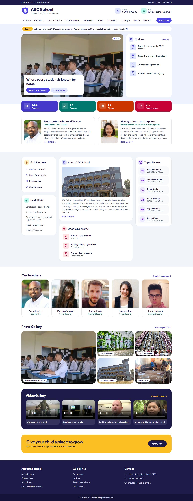
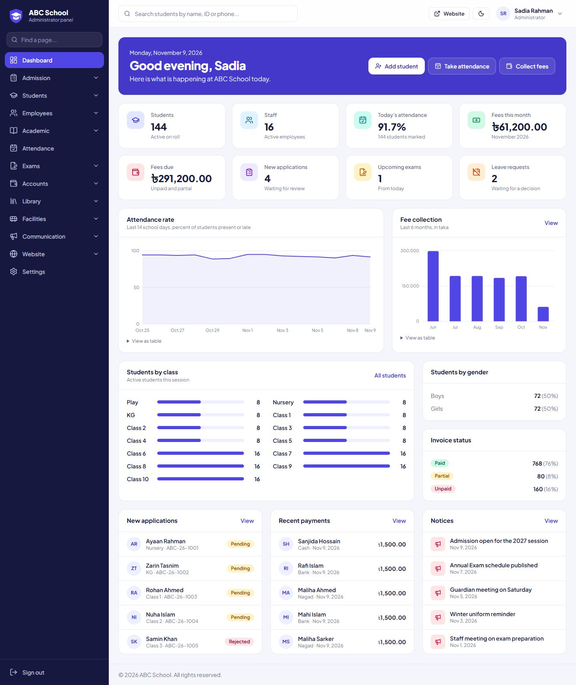
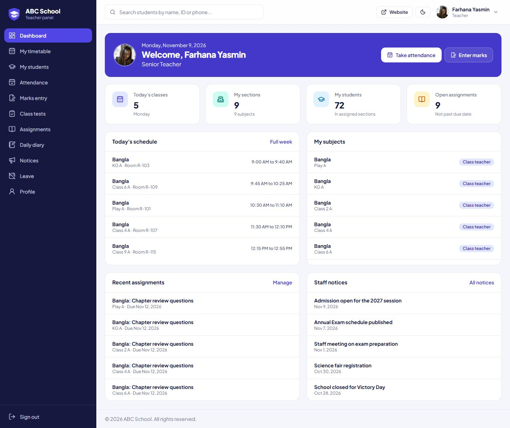
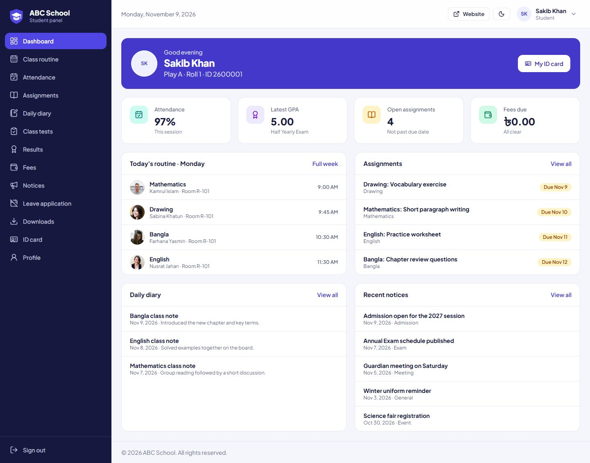
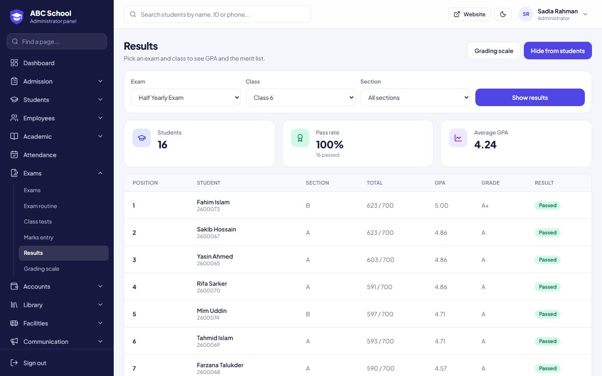
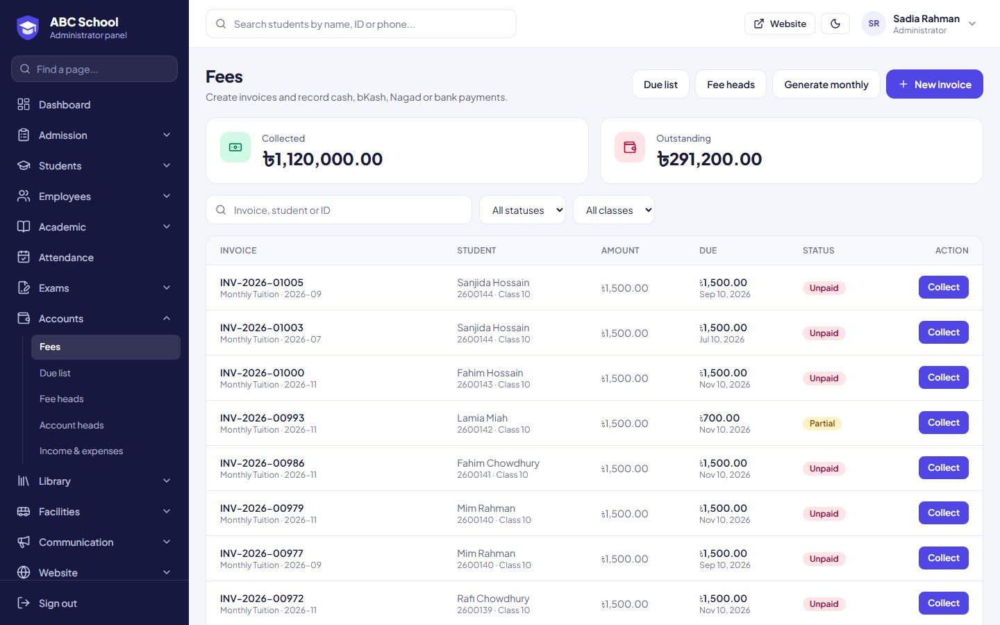
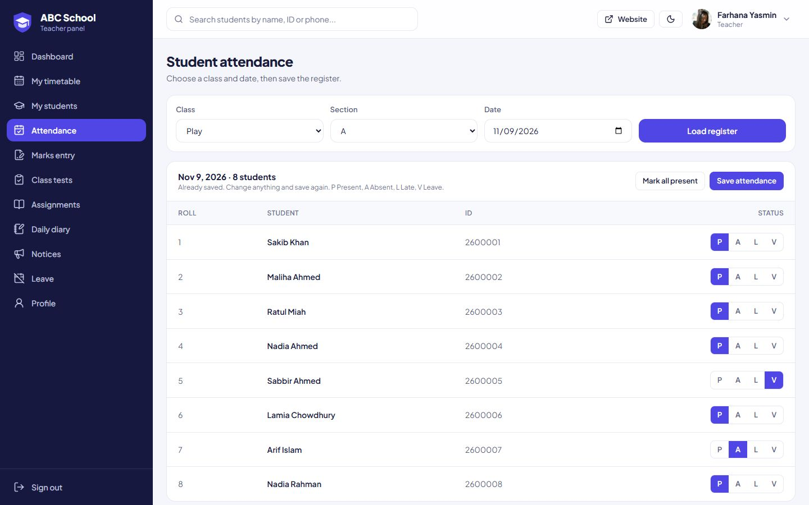

# School Management System

A full-stack school management system built with Laravel. It brings admissions, attendance, exams, results, fees, staff and communication into one application, with a public school website and separate workspaces for administrators, teachers and students.

## Landing page

The public website gives parents, students and visitors one place for school news, people and services.



## Role-based dashboards

Each role signs in to its own workspace and sees only the pages and records it is allowed to use.

**Administrator:** school-wide attendance, fees, admissions and exams at a glance



**Teacher:** today's classes, assigned subjects and attendance reminders



**Student:** routine, assignments, results, fees and notices



## Best features

**Results and merit list:** calculates GPA and class position from entered marks, and publishes results when they are ready



**Fee management:** creates invoices, records cash, bKash, Nagad and bank payments, and tracks what is still due



**Attendance register:** teachers mark a whole class in one screen, limited to the classes assigned to them



## Features

**Public website**
- Home page with notices, leadership messages, teachers, photo and video galleries
- Online admission form, contact form and result lookup
- Editable pages for school information, rules and activities

**Administrator**
- Dashboard with attendance, fee and enrolment insights
- Student records, online admissions and class promotions
- Employees, staff attendance, leave and payroll
- Academic setup, teacher assignment and timetable with clash detection
- Exams, marks entry, GPA calculation, merit lists and result publishing
- Invoices, fee collection, due list and income and expense records
- Library, transport, hostels, notices and website content

**Teacher**
- Personal dashboard and timetable
- Attendance and marks entry, limited to assigned classes and subjects
- Class tests, assignments, daily diary and leave requests

**Student**
- Dashboard, class routine and attendance history
- Assignments, daily diary, class tests and published results
- Fee statements, notices, leave applications, downloads and a printable ID card

## Tech stack

- PHP 8.4 and Laravel 13
- Blade, Tailwind CSS 4 and Alpine.js
- SQLite by default (MySQL through `.env`)
- Vite

## Getting started

Requirements: PHP 8.3 or newer with the `pdo_sqlite`, `mbstring`, `openssl`, `fileinfo` and `gd` extensions, Composer, and Node.js 20 or newer.

```bash
git clone https://github.com/sanaulislamzihad/School_Management_System.git
cd School_Management_System

composer install
npm install

cp .env.example .env
php artisan key:generate
touch database/database.sqlite
php artisan migrate --seed

npm run build
php artisan serve
```

Open <http://localhost:8000>. For frontend development, run `npm run dev` alongside `php artisan serve`.

Run the automated tests with:

```bash
php artisan test
```

### Demo accounts

These accounts exist only in the seeded demo data. Change them before any real deployment.

| Role | Sign-in page | User ID | Password |
| --- | --- | --- | --- |
| Administrator | `/staff-login` | `admin` | `admin123` |
| Teacher | `/staff-login` | `T1002` | `teacher123` |
| Student | `/student-login` | `2600001` | `student123` |

## Project structure

```text
app/Http/Controllers   Public site, admin, teacher and student portal controllers
app/Services           Result, grade and GPA calculation
app/Support            Navigation, dropdown lookups and resource page configuration
database/migrations    Database schema
database/seeders       Demo school data and website content
resources/views        Blade templates for the website and dashboards
```

## Media credits

Demonstration photos and videos come from Wikimedia Commons under free licences. Staff portraits are placeholders from randomuser.me. Full attribution is available on the `/credits` page and in `resources/data/media.json`. Replace these with the school's own media before going live.
